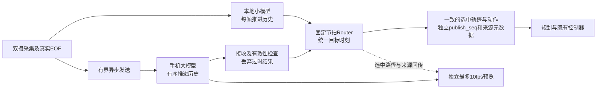

# C3XL / OPIF 双模型连续路由与低延迟方案评审

日期：2026-09-28。范围为只读核查及方案设计；未修改设备代码、控制参数、USB模式，未启动新推理或性能测试。目标设备172.16.1.202、comma-9c13c9f5；分支sp-dev-mac，HEAD 7bd33b5ca7d93f91bcb73c2947a045e06847f244。部署目录有未提交/未跟踪文件，以本目录device/快照及source-sha256.json为准。手机仍为OPIF 0.1.3/code4。

## 结论

方向可行。推荐“大模型合格且新鲜时优先、小模型持续热备、固定发布节拍的结果路由、单帧过时结果丢弃、故障分级与带滞回的自动恢复”。不推荐把转向/加速度数值按没有收到帧的时长直接乘大或乘小。网络和预览优化必须服务于摄像头采集结束到控制实际取用的帧龄与最大输出空窗。

当前allow_control=false、prefer_control=false，手机是shadow；现有5分钟测试通过不是大模型控车验证。本轮只提出设计，不开控制资格。

## 当前代码与用户目标的差距

| 位置（device/下对应文件） | 已确认行为 | 所需改变 |
|---|---|---|
| external_host/qnn_hotstandby.py:194-223 | 小模型逐帧执行，远端提交后本地运行；有真正热备 | 保留两个独立历史，避免为大模型放弃本地新鲜度 |
| 同文件:56,184-189,215-243,271-294 | 20连续输入后启动远端，200有效输出且允许控制后晋升 | 将初次资格、状态重建与短暂迟到后的恢复分别定义 |
| 同文件:128-140、qnn_model.py:247-249 | 任意远端异常关闭会话并latched_local | 单帧迟到成为可恢复drop，不等同身份/计算故障 |
| session.py:36-61、opif_client.py:137-170、opif_process.py:119-140 | 多层分别检查队列、顺序与年龄；一项过时可阻止后续新项 | 统一按请求记账，过时项有明确终态；每层协调修改 |
| qnn_model.py:187-227 | 本地回调之后才消费完成队列，还可等待最多10ms | 及时收取有效结果，固定发布tick不等待远端 |
| qnn_hotstandby.py:261-289 | 大模型暂缺时可能返回None；晋升为保持原frameId单调会暂停发布 | 控制发布序号与源捕获帧号分开，禁止伪造旧图像时间 |
| selfdrive/selfdrived/model_failure_gate.py:9-10及events.py:236-238 | latched_local会进入bigModelFailed，含SOFT_DISABLE路径 | 定义可维持的降级与系统不可用，不能只改模型选择器 |
| modeld.py:429-452,789-800 | 按选定源解析action/plan并平滑；使用捕获时上下文 | 显式统一动作目标时刻、单位、车辆状态与输出来源 |

设备opif/transport.py和tcp_wire.py与本地工作树版本不同。本目录保存了设备原件，不用本地候选代表已部署行为。

已有故障记录（不是本轮新测试）说明了当前消费问题：frame477到父进程时144.840ms，取用时201.624ms；其后frame478已经到达，取用检查时仍约151.634ms。代码对前者抛异常而未选择后者。本地回调耗时39.301ms，父进程到取用等待56.784ms。原证据为 ../opif-consumer-fix-20260928-171814/pre-local-consume/captured-timing.json。修调度和结果丢弃语义有明确依据，不能把全部延迟归因到TCP。

## 1. 丢帧必须区分输入和输出

- **已执行但超过控制截止的输出**：不进入控制；消费其协议终态，记录drop原因，允许后续新鲜结果。若输入已按正确顺序执行，手机递归状态可保持，不因一个晚结果重置整个会话。
- **未执行/真正缺失的输入**：涉及Cinque图内历史。模型的图像、desire、feature队列按每次调用推进，不带可变delta-t。不能随意只推理“最新输入”后仍声称时间历史等价，也不能复制旧帧补齐后直接放行。
- **已经提交NPU的工作**：不假设可无代价取消。可让它完成并仅推进有效状态，结果若迟到则不控制。
- **持续积压/输入缺口**：小模型接管；明确gap、丢弃尚未执行的旧输入，必要时创建新state_epoch/reset并重建历史。在连续序列和历史重新合格之前，大模型只作候选/shadow。
- **硬错误**：模型/ABI身份不符、非有限输出、无法确认的状态推进等隔离远端；重复/旧epoch包若能明确识别则丢弃，不能让重发重复推进状态。

请求至少区分session_id、state_epoch、capture_id、request_id、history_step、deadline和执行状态。序号缺口是否只是“结果被丢弃”与“输入未执行”必须可判定；不能简单删掉当前所有连续性检查。

## 2. 推荐双模型路由

固定20Hz模型发布/路由节拍，保留现有下游控制频率；本地小模型持续热备，不是手机慢了才启动。候选收集与发布解耦，每个tick无需等待远端；保持QCOM/VisionIPC已验证的线程所有权，不能随手另开第二个QCOM线程制造缓存/上下文问题。

建议状态：LOCAL_WARMUP → BIG_PREFERRED；短暂晚结果转LOCAL_BRIDGE；大模型恢复后经BIG_RECOVERING重新进入BIG_PREFERRED。身份/计算故障进入HARD_FAULT_LOCAL；两端均无有效输出进入BOTH_INVALID并沿用系统不可用处理。资格未开时仍为SHADOW，不把这套状态机当作绕过资格的方法。

路由条件是“新鲜、时间对齐、历史连续、身份一致、输出合法且已具资格”的大模型优先；否则用有效小模型。大转小快速，小转大经过连续有效结果、差异检查及滞回；具体连续帧数/时间阈值需E2E标定，不能从上一轮5分钟shadow成绩直接推出控车阈值。

### Action和时间对齐

不采用 `action_big *= exp(-missing_time/tau)` 或“把小模型action增强”。弯道上把曲率衰减到零会趋向直行，刹车幅值衰减会减弱制动；这与小模型是否可靠没有对应关系。衰减对象应是候选资格或选择权重。

先路由，后受限平滑更容易验证。若确需过渡，只在两候选均有效、同单位、同目标时刻且相容时，对目标曲率/加速度做短时受jerk/曲率变化率约束的过渡。两轨迹分歧大时不要平均出第三条未经模型选择的路线，停止/紧急制动语义不能被普通平均稀释。过期大模型权重必须为0，不以“权重很小”为理由继续消费。

当前action_t是横纵向预测时间（秒），不是动作权重；大模型action[0]是横向加速度，现有代码还要除以v²转成曲率。小模型可能走plan解析。二者不能直接按同一原始action向量混合。

当前默认frame delay为100ms，结果实际到达时间变化不会自动修改已算出的action。直接action head不是一条可事后任意重采样的action曲线。需要给每个候选记录capture时间、预测目标时刻、有效时间窗、车辆状态/标定版本。基于轨迹的控制可先做ego-motion补偿与同一未来目标时刻重采样；继续使用learned action head时，需对action_t延迟估计及目标窗做显式校验，失配则选小模型，不能重跑整个带状态图只为“修action时间”而重复推进历史。

定义独立publish_seq/control_tick和source_capture_id/source_eof。router每tick单调发布，但保留真实大模型捕获时间。现有modelV2消费者若假定frameId单调，需用明确的新路由消息/适配层处理，不把旧远端数据重贴当前frameId。cameraOdometry建议保持稳定、独立的本地连续来源；lane-change、lead、path、meta等数据要保持各自时刻和来源一致，不能只替换action却让下游误认整套感知来自另一模型。

降级事件也需配套：大模型过时而小模型健康为degraded状态；两端无效/资格失败/数据损坏仍保留系统故障处理。不能粗暴移除bigModelFailed来隐藏不可用状态。

## 3. 手机预览以SP输出路径为准（用户追加修订）

用户明确：不要求复刻图片中的绿色半透明预测路径，可以按SP输出的路径显示。图片只作为双摄预览布局参考；路径数据与样式以当前SP为基础。

主路径采用C3端SP实际发布的modelV2.position（三维路径点），随Router选择大/小模型切换。它表示SP当前发布的模型路径，不能标成执行器必然走出的实际轨迹。若Router以后在规划层生成不同的融合路径，应明确增加对应输出，不能把原始modelV2.position冒充融合后的路径。

代码依据：sunnypilot/modeld_v2/fill_model_msg.py:95-99从选中plan写入modelV2.position/velocity/acceleration；selfdrive/ui/mici/onroad/model_renderer.py:130-162使用modelV2.position作为主路径，:190-269处理宽度/投影/渐变，:339-375按模式、纵向状态和路径设置绘制。现有颜色不表示大小模型来源，模型来源需要单独标注。

实现建议：
1. 沿用SP的路径形状、宽度、裁剪及适用的颜色/渐变规则，不固定为绿色；车道线、道路边缘作为可选叠加。
2. C3向手机发送轻量路径包：publish_seq、source、capture/frame/request/epoch、路径点、可选车道线/边缘、匹配标定与样式状态。无需回传完整视频或全部模型输出。
3. 主预览显示SP实际发布的选中路径；手机大模型原始预测可以作为可选对照，明确标注“候选/未采用”，不能替代主路径。
4. 手机图像来自已有模型输入；SP路径必须按真实帧号/采集时间与对应图像匹配。使用有界帧缓冲并成对更新；无法匹配时隐藏叠加或明确显示过期，不把当前小模型路径直接画到旧手机输入上。
5. 两路图像已经warp到512×256模型视图，分别使用MED/SBIG投影及匹配的高度/标定，不能直接照搬C3原始相机的屏幕坐标。复用的是SP路径数据和绘制语义，不是原HUD像素坐标。
6. 保留独立后台渲染、最多10fps、最新预览替换和生命周期generation检查。优先交付推理结果；路径回传/预览不得阻塞模型或控制。完整SP状态未收到时不要假造模式颜色。
7. 断流/过时灰化或隐藏路径并显示年龄。来源单独显示“大模型/小模型/恢复中”等Router状态；主路径来自SP，不靠绿色或画面观感猜当前来源。

当前OPIF已有双摄预览和后台像素转换，但没有上述轨迹叠加。MainActivity.kt:238为模型输入文案；InputPreview.kt:13-14只含位图/packed、requestId/generation；preview.h仅解码图像。jni_bridge.cpp:192-217及:320-348仍在结果返回前复制输入并调预览JNI，需要与前述低延迟优化一起处理。

## 4. 低延迟协议和有线/Wi-Fi

当前实测枚举是USB2 RNDIS：rndis_host、480M；C3通过usb0 172.17.253.235访问172.17.253.120:5555。480Mbps是链路协商速率，不等于有效吞吐，也没有证明手机/线材/接口可升USB3。

每帧原始模型输入393,216B，输出73,808B；20Hz净负载约74.724Mbps，未含封装/重传。现有TCP链路已设置NODELAY并使用非阻塞全双工pump，手机D2窗口为1个执行+1个等待。C3仍有整帧IPC拷贝、分层队列和过期项导致全会话失败的语义。

### 优化顺序

1. **先补真计时及截止语义**：EOF、预处理完成、发送/IPC、手机重组完成、排队/推理开始结束、响应入队/发送、C3接收/实际router取用。最终deadline以C3同一时钟计算。手机可用剩余预算/有误差界的时钟映射提前拒绝，但不能直接相减两端未同步的单调时钟，也不能从接收时重新给一整份TTL来掩盖传输时间。
2. **减少队列与复制**：保留独立I/O进程，评估预分配共享内存槽位+小descriptor；移出JNI预览；有界pipeline维持20Hz，不能改成发一帧等一帧造成吞吐下降，也不能扩大队列追吞吐。结果槽保留最新有效候选，已过时结果完成记账后丢弃。
3. **传输无关的OPIF v2消息层**：状态epoch、帧来源、deadline、accepted/executed/dropped/reset终态、模型schema/hash、输出内容清单；控制消息可靠有序，实时数据允许明确过期。先保持模型输入时序，再讨论按deadline取消未执行任务。
4. **有线候选**：当前RNDIS/TCP作为可比基线；确认设备支持后比较NCM，再评估AOA原生bulk以省去IP/TCP处理。AOA模式需Android支持且可能改变USB功能枚举，不能未经设备验证承诺收益。即使bulk也没有最低延迟保证。
5. **Wi-Fi候选**：设计帧级deadline/分片/重组/过期停止补片，比较现有TCP与QUIC DATAGRAM或有限重传UDP。QUIC DATAGRAM不重传应用数据但仍有拥塞控制和MTU限制；393KB输入必须分片，缺片可能导致整帧不可用。UDP/QUIC不会消除802.11链路层重传。FEC增加带宽/编码/排队，需实测，不预设更快。

选型依据是同输入、同App、同温度范围、同预览设置下，EOF→router取用的P50/P95/P99、>有效期比例、最长无有效输出间隔、恢复时间和CPU开销；不是ping平均RTT或NPU平均时延。最低延迟目前没有足够证据排名。

官方依据：[QUIC DATAGRAM RFC9221](https://www.rfc-editor.org/rfc/rfc9221.html)、[UDP准则RFC8085](https://www.rfc-editor.org/rfc/rfc8085.html)、[Android USB HAL/NCM](https://source.android.com/docs/core/permissions/usb-hal)、[Android AOA bulk](https://source.android.com/docs/core/interaction/accessories/aoa)、[Linux USB host API](https://docs.kernel.org/driver-api/usb/usb.html)。

### 优先候选：省略未被车端控制消费的hidden回传

已只读跟踪当前QnnModel/Parser/modeld/fill_model_msg/tap/offline capture：正常控制和发布没有消费hidden_state[2066:18450]的16,384个float，QnnModel只是透传。手机递归历史由三个独立state输出推进，不依赖C3回传这段hidden。

可设计full_f32和control_heads_f32两种协商结果schema，仅后者省略这65,536B；其它head保持原FP32字节。结果73,808→8,272B，回传净负载减少88.8%，但含上传的20Hz双向净负载只减少约14.0%（74.724→64.238Mbps），不能把88.8%宣传成整链路时延改善。

保留手机全量finite检查与完整输出诊断模式，C3按协商schema检查字段。现有固定长度、hidden透传回归和潜在raw调试有真实依赖，不能直接截旧包/填零。尤其本地split模型确实使用hidden历史，该优化仅限手机完整状态图的结果传输。此项可以在新无线传输栈前先做协议E2E比较，实际时延收益尚未测量。

### 对上一轮报告的更正

当前android/native/opif_protocol.cpp:340通过put32(body,0)硬编码queue_microseconds；:708存在waiting_，:364-367在完成后提交待执行请求。因此之前queue_ms=0只能证明返回字段为0，不能证明服务端没有排队。已更正上一轮REPORT.md文字并更新其SHA256SUMS；原始测量文件没有改写。其它已测推理时延/帧龄/输出一致性不因这一更正自动失效。

## 先写失败场景，再做E2E实现

必须覆盖：单个旧结果后仍有新鲜结果、结果丢失但状态已推进、输入丢失/未执行取消、重复和乱序、旧epoch迟到、相机帧号缺口、手机断连/重启/热降频、本地超时、两端失效、连续反复切换、曲率符号/单位不符、制动与加速冲突、动作预测目标时间错位、JSON状态滞后、预览开关/标定失效/图线错配。

每个端到端场景保留：固定输入或采集帧清单、两端精确模型/源码SHA、逐帧阶段时间、state_epoch/history_step、route事件与理由、实际采用源/目标时间、动作变化率、过期/丢弃原因、原始日志、截图或录像、重放脚本和结果JSON。先对当前代码复现，再实施，最后用真实双摄的离车执行器隔离链路验收；道路资格单独处理。不得实施后补单元测试代替这些证据。

优先落地顺序：A）错误分类、协议终态记账、无等待router与连续小模型输出；B）时间对齐、受限过渡、恢复滞回与事件分类；C）同帧手机轨迹预览及关键路径移出；D）共享内存/精简协议与有线/Wi-Fi候选对照。每阶段独立保留旧方案可回滚。
